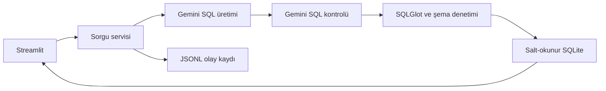

# NL2SQL Agent mimarisi

Streamlit, Türkçe iş sorularını alır. Servis soruyu Gemini ile SQLite sorgusuna çevirir, sorguyu denetler ve yerel veritabanında çalıştırır.

## Sorgu akışı

1. Model, SQLite şeması ve iş kurallarıyla birlikte soruyu alır. Belirsiz isteklerde açıklama ister, desteklenmeyen istekleri reddeder.
2. Arayüzde ikinci Gemini çağrısı aday SQL'i onaylar, düzeltir veya durdurur. Kontrol tamamlanamazsa SQL çalıştırılmaz. Komut satırı kabul testleri varsayılan olarak tek tur kullanır.
3. SQLGlot tek sorgu, tablo, sütun, CTE ve fonksiyon izinlerini denetler. SQLite bağlantısı salt-okunurdur. SQLite authorizer izin dışı işlemleri engeller.
4. Yürütme varsayılan olarak 5 saniye ve en fazla 500 görünür satırla sınırlıdır. Satır sınırı aşılırsa arayüz bunu bildirir.

Model `gemini-3.5-flash-lite`. REST istemcisi JSON çıktı, sıcaklık 0, en fazla 2048 çıktı tokenı ve düşük düşünme düzeyi kullanır. Varsayılan model zaman aşımı 60 saniyedir. Geçici bağlantı veya zaman aşımı hatasında her model turu en fazla bir kez tekrarlanır. İki turda da geçici hata olursa istek toplam iki tekrar yapabilir.

## Arayüz ve loglar

- Arayüz durumu, SQL'i, sonuç tablosunu ve CSV indirmeyi sunar. Takip soruları son üç ilgili turu bağlam olarak kullanabilir.
- Servis soru, üretilen ve yürütülen SQL, durum, hata türü, süre ve denemeleri `reports/events.jsonl` dosyasına yazar. API anahtarı redakte edilir.
- Log paneli son 200 kaydı filtreler, sayfa başına 10 kayıt gösterir ve seçilen kayıtları JSON olarak indirir.
